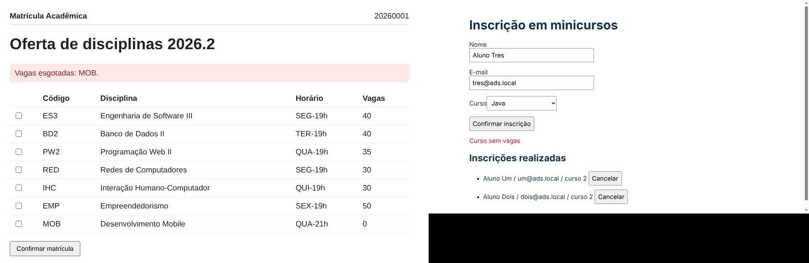

**Equipe:** Luiz Felipe de Lima Silva Tavares da Costa e Samuel Alves de Sousa · **Data:** 17/11/2026 · **Ferramentas:** Python 3.13, Selenium 4.53, pytest 9.1, pytest-html 4.2, Chrome 153 (headless)

## 1. Regras cobertas e matriz de casos

As matrizes completas, no formato do modelo e já com o resultado das 3 execuções, estão em
`pacote-A/desafio/matriz_casos_matricula.csv`, `pacote-B/desafio/matriz_casos_inscricoes.csv` e
`projeto-anterior/matriz_casos_produtos.csv`. O resultado esperado de cada caso foi escrito a partir
da regra do roteiro (ou do README do projeto), não do que a tela mostra.

| Suíte | Regras | Casos especificados | Automatizados | Execuções pytest (com variações) | Técnicas |
|---|---|---|---|---|---|
| Desafio A – matrícula | R1–R7 | 13 | 12 (CT13 é de concorrência, pela API) | 14 | partição, valor-limite 0/1/5/6 disciplinas e 1 vaga restante, tabela de decisão (horário) |
| Desafio B – inscrições | nome, e-mail, curso, duplicidade, lotação, cancelamento | 14 (12 mínimos + 2 de aparar espaços) | 14 | 19 | partição, valor-limite 2/3/60/61, tabela de decisão (e-mail × curso), transição de estado |
| Projeto – produtos-web | carregamento, contingência, busca, filtro, combinação, apresentação | 10 | 10 | 15 | partição, tabela de decisão (termo × filtro), consistência tela × API |

**Desafio A (resumo).** CT01 login válido; CT02 login inválido orientado a dados (senha errada,
matrícula inexistente, campos vazios); CT03 oferta sem login → login; CT04/CT05 1 e 5 disciplinas
aceitas; CT06/CT07 0 e 6 disciplinas rejeitadas com as mensagens exatas; CT08 choque ES3+RED; CT09
MOB esgotada por 5 matrículas preparadas pela API → "Vagas esgotadas: MOB." e ES3 não descontada;
CT10 matrícula prévia pela API → "Aluno já possui matrícula neste semestre."; CT11 sucesso com
`COMP-\d{6}`, disciplinas listadas e **exatamente** 1 vaga a menos em cada uma (as demais inalteradas);
CT12 última vaga de MOB aceita e vai a 0; CT13 corrida de 20 matrículas simultâneas do mesmo aluno (ver seção 4).

**Desafio B (resumo).** CT01 inscrição válida; CT02 mesmo e-mail em outro curso; CT03 nome vazio e só
espaços; CT04 cinco e-mails inválidos (sem @, nada antes do @, domínio sem ponto, espaço no meio, vazio);
CT05 sem curso; CT06–CT09 nome com 2, 3, 60 e 61 caracteres; CT09b/c espaços nas pontas não contam
(`"  Ana  "` aceito e gravado aparado; `"  Al  "` rejeitado); CT10 duplicidade com `"  MARIA@Ads.Local "`;
CT11 terceira inscrição no curso lotado; CT12 cancelar pelo botão `cancelar-ID` e reutilizar a vaga.

## 2. Estrutura do código

- **Page Objects** (`pages/`): uma classe por tela – `LoginMatriculaPage`, `DisciplinasPage`,
  `ComprovantePage` (A); `InscricoesPage` (B); `ProdutosPage` (projeto). Guardam localizadores e ações;
  nenhum `assert`. Os testes falam a língua do negócio (`oferta.selecionar("ES3","RED").confirmar()`).
- **Localizadores:** apenas `id` e `data-testid` (ex.: `#chk-ES3`, `[data-testid='disc-MOB'] .vagas`,
  `[data-testid='cancelar-3']`). Nenhum XPath.
- **Esperas:** só explícitas (`WebDriverWait`, `implicitly_wait(0)`, nenhum `sleep`). Telas com
  recarga (A) esperam a página antiga sair; telas com `fetch` (B e projeto) esperam a condição visível:
  mensagem preenchida, quantidade de itens na lista, término da chamada que carrega a lista.
- **Fixtures e dados:** `conftest.py` abre/fecha o Chrome e salva print em `evidencias/` quando um teste
  falha. Fixture `autouse` zera o estado antes de cada teste (`/api/admin/reset`, `/api/reset`);
  a API é usada só para montar pré-condições caras (ocupar vagas, matrícula prévia, curso lotado).
  A ação avaliada e a verificação principal são sempre pela tela.
- **Rejeições provam que nada foi gravado:** no A, comparamos o mapa completo de vagas exibido com o
  inicial; no B, recarregamos a tela e conferimos a lista.
- **Orientado a dados:** `pytest.mark.parametrize` em login inválido, limites de quantidade, e-mails
  inválidos, limites do nome, busca e tabela de decisão do projeto.

## 3. Resultado das 3 execuções

| Suíte | Execução 1 | Execução 2 | Execução 3 | Oscilou? |
|---|---|---|---|---|
| Exemplo A – fluxo de pedido (5) | 5/5 | 5/5 | 5/5 | não |
| Desafio A – 1ª rodada (antes da correção) | 14/14 | 14/14 | **13/14** | **sim** – CT09 |
| Desafio A – rodada registrada (após a correção) | 14/14 | 14/14 | 14/14 | não (+5 execuções extras: 14/14) |
| Exemplo B – login (2) | 2/2 | 2/2 | 2/2 | não |
| Desafio B – inscrições (19) | 19/19 | 19/19 | 19/19 | não |
| Projeto – produtos-web (15) | 14/14 + 1 xfail | 14/14 + 1 xfail | 14/14 + 1 xfail | não |

Arquivos: `resultados/<suite>/execucao_r1..r3.{xml,html,log}`; a 1ª rodada do desafio A ficou em
`resultados/rodada1_antes_correcao/`.

**Medido × interpretação.** A tabela acima e as contagens desta seção vêm direto dos arquivos JUnit XML e dos logs das execuções. As causas e explicações nos parágrafos abaixo, marcadas como **Interpretação**, são análise nossa.

**A oscilação do desafio A (interpretação).** Na 3ª execução, `test_ct09` falhou no login com
`unknown error: Node with given id does not belong to the document`. A causa não foi o sistema: a
espera `staleness_of` consulta o botão antigo enquanto a página está trocando, e o Chrome às vezes
devolve esse erro em vez de `StaleElementReferenceException`, que é o que a espera sabe tratar.
Corrigimos o Page Object com uma condição própria (`pagina_trocou`) que considera os dois erros como
"a página trocou", e rodamos de novo: 3 execuções oficiais + 5 extras, 112 testes, nenhuma falha.

**Exemplo B no nosso ambiente (interpretação).** O `conftest.py` do pacote não passa `--no-sandbox`, e o Chrome não
abre como *root* dentro de contêiner (2 erros de criação de sessão na 1ª rodada). Sem alterar o
exemplo, apontamos `CHROME_BINARY` para o lançador do Chrome que já acrescenta a opção; os 2 casos
passaram nas 3 execuções.

## 4. Defeitos encontrados

| ID | Sistema | Passos | Esperado | Obtido | Evidência |
|---|---|---|---|---|---|
| D1 | Projeto (API) | `GET /api/products?q=%20%20ervilha%20%20` | `[Ervilha]` – a tela apara espaços (caso P03 passa) | `[]`: a API não apara o termo; tela e API discordam | `test_d01_api_busca_com_espacos_igual_a_tela` (xfail estrito nas 3 execuções) |
| O1 | Pacote B (API) | Inscrever 2 alunos no curso 1 e consultar `GET /api/cursos/1` | Vagas refletem as inscrições (0) | `/api/cursos/1` continua `"vagas": 2` com o curso lotado (a 3ª inscrição recebe "Curso sem vagas") | `resultados/observacao_vagas_B.txt` |

Nenhum defeito foi encontrado pela interface nas regras R1–R7 do Pacote A nem nas regras do Pacote B:
todos os resultados esperados (escritos a partir das regras) bateram. Também investigamos uma possível
corrida na regra R6 (CT13: 20 matrículas simultâneas do mesmo aluno): o sistema respondeu certo nas 5
tentativas (1 × 201, 19 × 409), então **não** registramos defeito. O xfail do projeto entra na contagem como
"passou como esperado": ele só falharia (XPASS) se o defeito D1 fosse corrigido. O1 é uma observação: o roteiro
não diz que o catálogo deve refletir as inscrições, mas os dois módulos mostram "vagas" com significados
diferentes, o que confunde o usuário.

## 5. Projeto anterior – *produtos-web*

Sistema de Programação para Internet II (`github.com/luizfelipettavares/produtos-web`): tela React 19 +
Vite que lista produtos agrupados por categoria, com busca por nome e filtro "só em estoque"; API
Express 5 opcional (`/api/products?q=&inStock=`), com volta automática para dados locais se a API falhar.
Rodamos o build da API (`:3000`) e o `vite preview` da tela (`:4173`) em localhost.

**Fluxos testados:** (1) busca por nome e (2) filtro de estoque, mais a combinação dos dois (tabela de
decisão), o carregamento pela API e a **regra de contingência** (API fora → "Dados locais."), testada
bloqueando a porta 3000 dentro do próprio Chrome (`Network.setBlockedURLs`), sem derrubar a API.
O sistema só lê dados, então não há estado a zerar: cada teste abre a página num navegador novo.

**Como os 10 casos cobrem o mínimo pedido.** Sucesso: P01, P03, P06, P07. Rejeição: o sistema só lê
dados e não tem formulário que recuse entrada; o mais próximo são as buscas sem resultado (P04 e a linha
"abóbora + só estoque" do P08), que mostram a mensagem de lista vazia. Regra de negócio: P08 (busca combinada
com estoque) e P02 (contingência com dados locais).

**`data-testid` adicionados (justificativa).** O original só tinha `id` no campo de busca; linhas,
categorias, preço, selo "em falta", mensagem de lista vazia e fonte dos dados só podiam ser achados por
classe CSS gerada pelo CSS Modules (muda a cada build) ou por XPath posicional – os dois proibidos. O patch
`projeto-anterior/patch/0001-data-testid.patch` acrescenta 13 atributos (`id`, `data-testid` e um `data-stocked`) em 5 componentes e não muda
comportamento nem visual.

**Limitações:** sem banco nem escrita, não há regra de negócio com estado; a busca não ignora acentos
("maca" não encontra "Maçã") – o README não pede isso, então registramos como sugestão, não como defeito.

## 6. Dificuldades e limitações da cobertura

- Telas com `fetch` (B e projeto) não recarregam: foi preciso esperar condições da página em vez da troca
  de página. Para provar "nada foi gravado" no B, recarregamos a tela e conferimos a lista.
- O Pacote A e o B guardam estado em memória compartilhada: as suítes rodam **em sequência**; rodar em
  paralelo (`-n`) quebraria o isolamento.
- Não cobrimos: navegadores além do Chrome, acessibilidade, layout/responsividade, segurança (o login do
  Pacote B é simulado e o painel não tem sessão – fora do escopo, conforme o README do pacote).
- CT13 (concorrência) não é testável pela interface com um único navegador; ficou como teste de API.

## Anexo A – Evidências de tela

Capturas da própria suíte (Page Objects) no momento da verificação: à esquerda o CT09 do desafio A (MOB esgotada, ES3 não descontada); à direita o CT11 do desafio B (terceira inscrição no curso lotado; a lista continua com 2).

## Anexo B – Matrizes de casos (resumo)

Versão completa, com pré-condição, passos, asserção principal e arquivo/função de cada caso, nos CSV citados na seção 1.

### Desafio A – portal de matrícula

| ID | Regra | Técnica | Dados | Resultado esperado | Status (3 execuções) |
|---|---|---|---|---|---|
| CT01 | R1 - Login | Partição (válida) | 20260001 / senha123 | Oferta de disciplinas aberta com o aluno no cabeçalho | aprovado |
| CT02 | R1 - Login | Partição (inválidas) - orientado a dados | senha errada; matrícula inexistente 20269999; campos vazios | "Matrícula ou senha inválidas." e permanece no login | aprovado |
| CT03 | R2 - Acesso | Partição (sem sessão) | - | Redireciona para /matricula/login | aprovado |
| CT04 | R3/R7 - Quantidade | Valor-limite (1) | ES3 | Matrícula realizada com sucesso! | aprovado |
| CT05 | R3/R7 - Quantidade | Valor-limite (5) | ES3,BD2,PW2,IHC,EMP | Matrícula realizada com sucesso! | aprovado |
| CT06 | R3 - Quantidade | Valor-limite (0) | nenhuma | "Selecione ao menos uma disciplina." | aprovado |
| CT07 | R3 - Quantidade | Valor-limite (6) | ES3,BD2,PW2,IHC,EMP,MOB | "Máximo de 5 disciplinas por semestre." | aprovado |
| CT08 | R4 - Horário | Tabela de decisão (mesmo horário) | ES3 + RED (SEG-19h) | "Choque de horário entre disciplinas selecionadas." | aprovado |
| CT09 | R5 - Vagas | Partição (sem vagas) | ES3 + MOB | "Vagas esgotadas: MOB." | aprovado |
| CT10 | R6 - Matrícula única | Partição (já matriculado) | BD2 | "Aluno já possui matrícula neste semestre." | aprovado |
| CT11 | R7 - Sucesso | Partição (válida) + verificação de efeito | ES3,BD2,IHC | Sucesso, comprovante COMP-NNNNNN, disciplinas listadas, 1 vaga a menos em cada | aprovado |
| CT12 | R5/R7 - Vagas | Valor-limite (1 vaga restante) | MOB | Matrícula aceita e MOB vai a 0 | aprovado |
| CT13 | R5/R6 - Concorrência | Teste exploratório de concorrência | 20 POST /api/matriculas simultâneos do mesmo aluno | Exatamente 1 x 201 e 19 x 409 | aprovado (execução manual do script) |

### Desafio B – inscrições em minicursos

| ID | Regra | Técnica | Dados | Resultado esperado | Status (3 execuções) |
|---|---|---|---|---|---|
| CT01 | Fluxo válido | Partição (válida) | Maria Silva / maria@ads.local / Python | "Inscrição realizada" e item na lista | aprovado |
| CT02 | Duplicidade (outro curso) | Tabela de decisão (mesmo e-mail, curso diferente) | maria@ads.local / Java | Aceita: "Inscrição realizada" | aprovado |
| CT03 | Nome | Obrigatório - orientado a dados | nome vazio; só espaços | "Nome deve ter de 3 a 60 caracteres" | aprovado |
| CT04 | E-mail | Partição (inválidas) - orientado a dados | sem @; nada antes do @; domínio sem ponto; espaço no meio; vazio | "E-mail inválido" | aprovado |
| CT05 | Curso | Obrigatório | curso = Selecione | "Curso obrigatório" | aprovado |
| CT06 | Nome | Valor-limite (2) | 'AA' | Rejeita: "Nome deve ter de 3 a 60 caracteres" | aprovado |
| CT07 | Nome | Valor-limite (3) | 'AAA' | Aceita | aprovado |
| CT08 | Nome | Valor-limite (60) | 60 x 'A' | Aceita | aprovado |
| CT09 | Nome | Valor-limite (61) | 61 x 'A' | Rejeita: "Nome deve ter de 3 a 60 caracteres" | aprovado |
| CT09b | Nome/E-mail (aparar) | Valor-limite com espaços | '  Ana  ' / '  ana@ads.local  ' | Aceita e grava aparado | aprovado |
| CT09c | Nome (aparar) | Valor-limite com espaços | '  Al  ' (2 após aparar) | Rejeita: "Nome deve ter de 3 a 60 caracteres" | aprovado |
| CT10 | Duplicidade | Tabela de decisão (mesmo e-mail normalizado, mesmo curso) | '  MARIA@Ads.Local ' / Python | "Inscrição já existente" | aprovado |
| CT11 | Lotação | Valor-limite (3ª inscrição) | tres@ads.local / Java | "Curso sem vagas" | aprovado |
| CT12 | Cancelamento | Transição de estado | cancelar o 1º; nova inscrição tres@ads.local no curso 3 | "Inscrição cancelada", item some; nova inscrição aceita | aprovado |

### Projeto anterior – produtos-web

| ID | Regra | Técnica | Dados | Resultado esperado | Status (3 execuções) |
|---|---|---|---|---|---|
| P01 | Carregamento | Partição (API no ar) | - | 6 produtos agrupados em Frutas e Verduras; rodapé 'Dados da API REST.' | aprovado |
| P02 | Contingência | Partição (API fora) | - | Usa dados locais e mostra 'Dados locais.' | aprovado |
| P03 | Busca por nome | Partição - orientado a dados | 'maçã'; 'MA'; '  ervilha  '; 'a' | Só produtos cujo nome contém o termo, sem diferenciar maiúsculas e ignorando espaços nas pontas | aprovado |
| P04 | Busca por nome | Partição (sem resultado) | 'chocolate' | Mensagem 'Nenhum produto encontrado...' | aprovado |
| P05 | Agrupamento | Partição | 'pitaya' | Só a categoria Frutas aparece | aprovado |
| P06 | Filtro de estoque | Partição (marcado) | checkbox marcado | 4 produtos, nenhum com selo 'em falta' | aprovado |
| P07 | Filtro de estoque | Transição (marcar/desmarcar) | - | Volta aos 6 produtos | aprovado |
| P08 | Busca + estoque | Tabela de decisão (termo x filtro) | 'ma' sem/com filtro; 'abóbora' com filtro | [Maçã, Maracujá]; [Maçã]; vazio com mensagem | aprovado |
| P09 | Apresentação | Partição | - | Em falta com selo (Maracujá, Abóbora); preço em R$ no formato pt-BR | aprovado |
| P10 | Busca por nome (API) | Consistência tela x API | q='  ervilha  ' | Mesmo resultado da tela: [Ervilha] | falhou (defeito registrado) |

## 7. Contribuição dos integrantes

| Integrante | Casos/código | Execuções e evidências | Relatório/slides |
|---|---|---|---|
| Luiz Felipe de Lima Silva Tavares da Costa | Desafio A (`matricula_pages.py`, `test_matricula.py`, 13 casos); correção da espera `pagina_trocou`; matriz de casos A | 3 execuções dos exemplos A e B e da suíte A (+5 extras); investigação da oscilação do CT09 | Seções 1, 2, 3 e 6 do relatório; slides do problema, código, oscilação e resultados do Pacote A |
| Samuel Alves de Sousa | Desafio B (`InscricoesPage`, `test_inscricoes.py`, 14 casos) e projeto anterior (`ProdutosPage`, `test_produtos.py`, patch de `data-testid`); matrizes de casos B e do projeto | 3 execuções das suítes B e do projeto; registro do defeito D1 e da observação O1 | Seções 4 e 5 do relatório; slides dos apêndices |

Os dois integrantes revisaram o relatório e os slides inteiros e ensaiaram a apresentação juntos.
